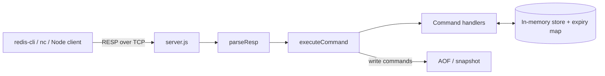

# Redis-Server

> A Redis-compatible in-memory data store built **from scratch in Node.js**, with zero runtime dependencies. It speaks the real **RESP** protocol over raw TCP, supports key expiry and lists, and persists data with an **Append-Only File (AOF)** or **JSON snapshots**.


```text
$ redis-cli -p 6379
127.0.0.1:6379> SET user:1 "jon"
OK
127.0.0.1:6379> EXPIRE user:1 60
(integer) 1
127.0.0.1:6379> RPUSH queue job1 job2 job3
(integer) 3
127.0.0.1:6379> LRANGE queue 0 -1
1) "job1"
2) "job2"
3) "job3"
```

## Why I Built This

I wanted to understand what happens *underneath* tools I use every day. Redis is small enough to build solo, but it covers real systems problems: **raw TCP and a text-framed protocol**, **typed in-memory data**, **key expiry**, and **durability** (making memory survive a restart). Building it forces the same design decisions the real thing had to make.

## Features

- **Real RESP protocol** over TCP, so `redis-cli` and other simple RESP clients can talk to it
- **Strings:** `SET`, `GET`, `DEL`, `INCR`, `DECR`
- **Lists:** `LPUSH`, `RPUSH`, `LPOP`, `RPOP`, `LRANGE` (negative indices supported)
- **Expiry:** `EXPIRE` and `TTL`, with lazy expiration (expired keys are removed when accessed)
- **Two persistence modes:** AOF (replayed on startup) or periodic JSON snapshots
- **Integration tests** that drive a live server over a socket
- **Zero runtime dependencies**

## Quick Start

Requires [Node.js](https://nodejs.org) 18.11 or newer.

```bash
git clone https://github.com/Meekal-Jiwani/Redis-Server.git
cd Redis-Server
npm start
```

The server listens on `127.0.0.1:6379` (the default Redis port, so stop any real Redis first). Try it with `redis-cli -p 6379`, or by hand with raw RESP:

```bash
printf '*3\r\n$3\r\nSET\r\n$3\r\nfoo\r\n$3\r\nbar\r\n' | nc -q1 127.0.0.1 6379   # +OK
printf '*2\r\n$3\r\nGET\r\n$3\r\nfoo\r\n' | nc -q1 127.0.0.1 6379                 # $3 bar
```

> `-q1` makes `nc` exit after sending, otherwise it can hang waiting for the connection to close. If your `nc` doesn't support `-q` (e.g. macOS), drop it or try `-w1`.

## Supported Commands

| Command | Syntax | Reply |
| --- | --- | --- |
| `SET` | `SET key value` | `+OK` |
| `GET` | `GET key` | bulk string, or `$-1` if missing |
| `DEL` | `DEL key [key ...]` | number of keys deleted |
| `EXPIRE` | `EXPIRE key seconds` | `:1` set, `:0` key missing |
| `TTL` | `TTL key` | seconds left, `-1` no expiry, `-2` missing |
| `INCR` / `DECR` | `INCR key` | new value (missing keys start at 0) |
| `LPUSH` / `RPUSH` | `LPUSH key v [v ...]` | list length |
| `LPOP` / `RPOP` | `LPOP key` | bulk string, or `$-1` if empty |
| `LRANGE` | `LRANGE key start stop` | array of elements |
| `FLUSHALL` | `FLUSHALL` | `+OK` (deletes all data and persistence files) |

Bad calls return Redis-style errors, such as `-ERR wrong number of arguments for 'SET' command` or `-ERR value is not an integer or out of range`.

## Configuration

Persistence settings live in [`src/config.json`](src/config.json). The host and port (`127.0.0.1:6379`) are set in [`src/server.js`](src/server.js).

| Option | Default | Description |
| --- | --- | --- |
| `appendonly` | `true` | Log write commands to `src/data.aof` and replay them on startup |
| `snapshot` | `false` | Save the full dataset to `src/data.rdb` every `snapshotInterval` ms |
| `snapshotInterval` | `5000` | Snapshot frequency in milliseconds |
| `aofCommands` | all writes | Which commands get logged to the AOF |

Use one persistence mode at a time. To use snapshots, set `snapshot: true` **and** `appendonly: false`; otherwise the AOF is still written but never replayed. With both off, the server is purely in-memory. Set `DEBUG=server,core,persistence` to filter log output.

## How It Works



| File | Responsibility |
| --- | --- |
| `src/server.js` | TCP listener; sends each incoming command to the engine |
| `src/core.js` | Command handlers, dispatcher, expiry checks |
| `src/persistence.js` | Owns the store; AOF writing and replay, snapshots |
| `src/utils/` | RESP encoder/parser and a namespaced logger |
| `tests/server.test.js` | End-to-end tests against a live server |

**RESP.** `SET foo bar` arrives as `*3\r\n$3\r\nSET\r\n$3\r\nfoo\r\n$3\r\nbar\r\n`: an array of three bulk strings, each prefixed with its byte length. The same parser reads client traffic and the AOF.

**Persistence.** Every successful write is appended to the AOF in RESP form (asynchronously, so disk I/O never blocks clients). On startup the log is replayed through the normal `executeCommand` path, so there is one source of truth for behaviour. `EXPIRE` is stored as an absolute deadline, so a restart does not reset the timer. Snapshot mode trades durability (up to one interval can be lost) for faster startup and bounded file size.

## Testing

The tests connect to a **running** server and assert on the exact bytes returned:

```bash
npm start   # terminal 1
npm test    # terminal 2
```

> The test run starts with `FLUSHALL`, which **erases all data** in the server. Don't run it against data you care about.

## Design Decisions

- **Single-threaded and event-driven**, like Redis itself, so there are no locks and no races on the store.
- **Async writes, sync startup.** Disk writes never block clients, and loading finishes before the server accepts traffic.
- **Lazy expiration.** Keys are checked when accessed instead of scanning the keyspace on a timer.
- **Zero dependencies**, so the focus stays on the fundamentals.

## Known Limitations

This is a learning project, not a production database. Each TCP packet is treated as exactly one command: pipelined commands are not supported (only the first in a packet runs; the rest are silently dropped), and a command split across packets returns an error. Very large values are not handled, the AOF is never compacted, and expiry is lazy only.

**Next up:** `PING`, `EXISTS`, `KEYS`, hashes and sets, Pub/Sub, `AUTH`, a background expiry sweeper, and CI.

## License

MIT. See [`LICENSE`](LICENSE).

**Meekal Jiwani** · Computer Science student at Simon Fraser University · [@Meekal-Jiwani](https://github.com/Meekal-Jiwani)
